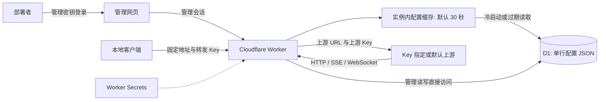
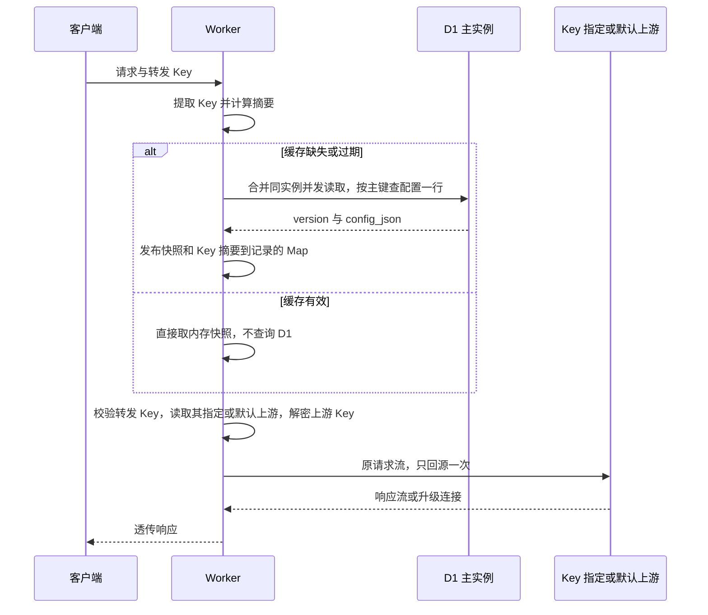

# thin-proxy 架构文档

版本：V1.9（单上游转发与低成本登录防护）
日期：2026-11-06
关联：[需求文档](./01-需求文档.md) · [设计文档](./02-设计文档.md)

## 1. 总体架构

采用一个 Worker、一个 D1 数据库、同源静态管理页面。单用户使用，不建立用户体系；每个转发 Key 指定一个上游或跟随默认，每次请求只回源一次。D1 持久化一份配置，Worker 实例内存缓存默认 30 秒，网页登录使用无需数据库会话表的短期签名 Cookie 与 Cloudflare 内建限速绑定。



管理密钥、网页会话与转发 Key 在代码中分别验证，不互相回退。网页会话不能调用代理，转发 Key 不能管理配置。

## 2. 技术选择

建议 TypeScript + 简单路由，页面使用 HTML / CSS / TypeScript，静态资源与 Worker 同部署，Wrangler 管理部署与迁移。无需大型框架、独立服务器、Redis、队列、Durable Objects 或本地常驻程序。

D1 仅保存 config 表固定一行：id、version、config_json、updated_at。JSON 包含上游 URL 与鉴权配置、加密上游 Key、转发 Key 摘要与加密副本、单个上游绑定和必要元数据、全局当前上游 ID。不建用户表、会话表、请求日志表，不存聊天内容或统计数据。

第一版使用模块级配置缓存，命中不查 D1；过期或冷启动读取完整配置，在内存建立转发 Key 摘要到记录的 Map。默认 TTL 30 秒，通过 CONFIG_CACHE_TTL_SECONDS 配置，0 表示每次读取。D1 不启用读取副本；若未来启用，刷新及管理读写必须明确使用主实例，例如部署时确认支持的 first-primary 会话方式，避免额外的副本陈旧时间。

内存仅属于当前实例，不共享、不保证常驻。每个实例都有自己的冷启动和刷新次数，不能估算成全站固定每 30 秒一次查询。无流量时不主动轮询；D1 计量按实际扫描行数，单行配置减少每次读取扫描量，内存缓存进一步减少读取次数。不为每个请求额外查询配置版本号。

## 3. 模块划分

```text
src/
  index.ts           管理与代理路径分流、异常边界
  auth.ts            独立验证管理密钥、会话和转发 Key
  proxy.ts           URL、鉴权替换、HTTP/SSE/WebSocket
  admin.ts           上游、全局选择、转发 Key 管理及明文查看
  storage.ts         D1 单行读取、旧配置规范化、版本条件更新
  login-limit.ts     管理登录限速，无数据库计数
  cache.ts           配置快照、30 秒 TTL、合并并发加载
  crypto.ts          随机 Key、摘要、两类 Key 按用途隔离加解密
  validation.ts      URL 与参数校验
web/                 登录页和唯一管理页面
migrations/          config 表与空配置单行初始化
wrangler.jsonc       Worker、D1、静态资源绑定
```

仅保留管理前缀进入页面及管理 API；其他路径一律进入代理，防止 SPA fallback 截获业务请求。

## 4. 请求链路



从同一不可变快照验证 Key 并选择上游，区分无效 Key、暂停的 Key 和未选上游；有效缓存中未知 Key 直接拒绝，不触发强制刷新。加载失败且无未过期缓存时返回 503，不回源。业务体不调用 json() / text() 整包读取；热路径不记录调用统计或写请求日志表。每个请求只回源一次，HTTP 错误原样返回，不跟随重定向。网络错误返回 502，响应头超时返回 504；任何结果均不改变路由或写入 D1。

proxy.ts 的职责限定为反向代理，不引入请求或响应协议转换层。业务体按不透明流传递，不解析 JSON、表单、SSE 事件或 WebSocket 消息，不调整字段层级、不解包或套壳。URL、方法、鉴权头、升级信息及上游 HTTP 状态参与代理决策。所有请求体直接传递原流，不预读、缓存或重放，不设置应用级大小上限。管理配置解析与业务流转发分开实现。

实现使用 Workers 原生 Fetch、Streams 与 WebSocket 能力，可以借鉴 Nginx 的反向代理语义，但不移植 Nginx 源码。Nginx 的 C 代码及其进程、套接字、事件循环依赖不适用于直接复制到 TypeScript Worker；也不为此引入 WASM 移植层。

## 5. SSE 与 WebSocket

SSE 直接返回上游响应流，不解析事件、添加心跳或整包缓冲。不使用 Cache API，部署中也明确禁止代理路径缓存，并验证回源缓存行为。客户端断开时尽可能取消上游流；取消传播需部署验证，不能保证上游停止生成或计费。

WebSocket 先验证转发 Key，再按该 Key 的指定或默认上游替换握手 URL 和鉴权。优先使用 Workers 原生升级透传：向上游 Upgrade fetch 后直接返回升级响应，不主动接管逐条消息。

101 响应不能只复制 body 与 headers 当普通响应重建；确需重建时必须保留平台 WebSocket 对象。非成功握手直接透传，不切换上游。

验证文本、二进制、子协议、关闭及握手失败。扩展协商受运行时限制，不承诺帧边界、压缩或 ping/pong 逐字一致。不做连接注册、踢下线、自动重连、消息级鉴权替换。具体上游是否支持目标接口须实际联调。

等待响应头的计时器按每次回源创建，取得响应头或失败即清除，不将超时用于已接受的 SSE / WebSocket。失败响应保留原 body 返回客户端。`enable_request_signal` 显式启用客户端取消通知，已观察到的取消会终止当前回源；实际平台的取消传播仍需部署验证。参见 [Cloudflare Request](https://developers.cloudflare.com/workers/runtime-apis/request/) 与 [兼容标志](https://developers.cloudflare.com/workers/configuration/compatibility-flags/#enable-requestsignal-for-incoming-requests)。

请求体直接流式转发，实际请求大小与资源使用仍受 [Workers 平台限制](https://developers.cloudflare.com/workers/platform/limits/) 和上游限制。

旧多上游配置在 storage.ts 读取时选第一项，旧故障状态被忽略。读取不写库、不改 Key；下一次真实管理编辑自然保存单上游结构，无需额外迁移。

## 6. 一致性与凭据生命周期

- 管理 API 直接读取 D1 最新配置，验证当前项引用、Key 摘要唯一等约束后，以 WHERE version = 读取版本进行原子条件更新并递增版本；发生冲突返回 409，不覆盖并发修改。
- 管理页通过 `/snapshot` 一次读取取得同版本的配置、脱敏上游及 Key 列表。常规配置编辑校验后若配置未变化，跳过写入，不递增版本、不刷新缓存 TTL；真实修改保留版本条件更新。Key 的绑定上游变化视为修改。
- 实际修改保存成功表示 D1 已提交，随后发布该版本至本实例缓存；其他实例过期后读取新配置，切换和 Key 创建、绑定修改、撤销默认可能延迟约 30 秒，不保证保存后全球立即生效。
- TTL 从读取发起时计时，命中不续期，避免较慢读取或频繁访问延长旧配置的寿命。超过 TTL 才返回的读取结果仅供本次等待请求使用，后续请求必须刷新。
- 同实例使用共享加载 Promise 合并并发读取，结束后清除；无请求时不轮询。缓存过期后同步等待刷新，失败报错，不后台刷新并继续用过期配置。
- 缓存按版本单调发布，慢读取或较旧管理提交不得覆盖较新缓存或延长旧版本 TTL；等待旧加载的请求优先使用已发布的新版本。
- 已取得旧快照的在途请求允许继续使用旧上游；过期后发起配置读取的请求须读取最新主实例配置，读取耗时与平台故障不包含在约 30 秒的陈旧窗口说明内。
- 已建 SSE / WebSocket 不重复查库，不中途迁移。
- 修改上游 URL 或 Key 同样遵守缓存刷新规则。
- 撤销转发 Key 从 JSON 列表移除摘要；其他实例缓存到期前仍可能接受该 Key，不保证中断已认证请求或长连接。
- 删除与切换通过版本条件更新保持引用完整，删除默认上游或被 Key 绑定的上游返回冲突。
- 管理密钥轮换生效后旧管理会话失效，但已有转发 Key 不受影响。
- 撤销任一转发 Key 不改变管理会话、其他 Key 或当前上游。

## 7. Secret 与密钥存储

| 配置 | 类型 | 用途 |
| --- | --- | --- |
| ADMIN_KEY | Worker Secret | 唯一管理网页登录凭据 |
| UPSTREAM_KEY_ENCRYPTION_KEY | Worker Secret | 上游 Key 与转发 Key 副本加解密，32 字节随机值的 Base64 编码 |
| DB | D1 binding | 配置 JSON、版本及更新时间，无会话记录 |
| CONFIG_CACHE_TTL_SECONDS | 普通部署变量 | 配置缓存 TTL，默认 30，0 表示每次读取 |
| UPSTREAM_TIMEOUT_SECONDS | 普通部署变量 | 每次回源等待响应头的超时秒数，默认 300，大于 0 且最多 300 |
| ADMIN_LOGIN_LIMITER | Rate Limiting binding | 每 IP 每机房近似 5 次登录尝试/分钟，不访问 D1 |
| 静态资源绑定 | Asset binding | 网页文件 |

加密 Secret 是实现内部配置，不是另一类登录或调用凭据。管理密钥应足够随机，不写入代码、前端产物或日志。

转发 Key 使用安全随机数生成，数据库保存鉴权摘要及可恢复的加密副本。副本使用同一加密 Secret，但 AAD 为 worker-relay/access-key/v1:ID，与上游的 worker-relay/upstream/v1:ID 隔离，不能交换用途或记录。摘要验证仍在请求热路径独立完成；只有管理员主动查看时才解密副本。旧摘要 Key 不补造密文、不影响调用。上游 Key 使用 AES-GCM，每次写入使用新随机 96 位 nonce，以用途标识和上游 ID 作为附加认证数据，记录密钥版本；内存快照保留密文，回源前解密，明文不回显或放入模块级缓存。

管理 Cookie 仅包含用途、签发时间、到期时间及随机 nonce。通过 HKDF-SHA-256 从 ADMIN_KEY 派生带专用用途标识的签名密钥，使用 HMAC-SHA-256 签名；每次管理请求验证签名、用途和有效期，无需 D1 查询。建议有效期 1 小时，不自动续期，不保存令牌或摘要到 D1。Secret 轮换生效后旧签名失效；退出清除当前浏览器 Cookie，不提供已复制令牌的单独服务端撤销。

恢复上游配置及转发 Key 明文同时需要数据库备份与加密 Secret。加密密钥轮换应保留旧密钥，完成重新加密并验证后移除；不能直接替换导致历史配置不可读。管理密钥轮换无需重新加密上游配置。

## 8. 最小安全约束

管理修改操作含登录校验同源 Origin；管理 Cookie 使用 Secure、HttpOnly、SameSite=Strict，敏感响应禁止缓存。代理只访问已保存上游，不允许请求参数指定任意目标。

保存 URL 时拒绝 HTTP、嵌入凭据、查询字符串、fragment、本机地址及明显私有或保留 IP 字面量；拒绝本 Worker 已知域名避免循环。字符串校验不等于完整 DNS 防护；本版仅由唯一管理者配置受信任上游，不提供公众配置入口。

出站移除转发凭据及项目专属网页会话 Cookie，不自动携带 Key 跟随跳转。不记录密钥、业务消息或完整带查询参数的 URL，不暴露底层请求对象和异常堆栈。

登录拒绝公开示例和明显弱 ADMIN_KEY；限速键使用部署密钥与 CF-Connecting-IP 的摘要，避免保存明文 IP。限速在机房内近似执行，既有会话验证不受登录计数影响；绑定失败时拒绝新登录。默认关闭 Workers 持久化调用日志，降低 URL 数据留存和日志成本。

数据库加密只降低单独泄漏数据库的风险；持有代码、数据库和 Secret 的部署者仍可解密上游 Key。

## 9. 部署与验证

1. 创建 D1，迁移 config 表并初始化空配置单行及版本。
2. 写入管理密钥、上游加密 Secret，绑定数据库，配置默认 30 秒 TTL。
3. 构建管理页面，配置保留路径并部署 Worker。
4. 用管理密钥登录，添加上游并选择当前项。
5. 创建转发 Key，在客户端配置固定地址和该 Key。
6. 使用两个测试上游和两个转发 Key 验证切换与撤销。

部署前核对实际套餐和当前平台请求体、CPU、子请求、D1、长连接限制，不承诺无限连接或免费套餐覆盖所有负载。

| 验证项 | 重点 |
| --- | --- |
| 凭据隔离 | 转发 Key 不能管理，管理密钥和会话不能代理 |
| Key 生命周期 | 多 Key 可用、独立撤销、管理 Secret 轮换不影响转发 |
| 全局选择 | 本实例提交后更新，其他实例在缓存过期刷新后切换，未绑定 Key 跟随默认上游，已绑定 Key 不受默认切换影响 |
| 缓存 | 命中零 D1 读取、冷启动、TTL 不滑动、同实例并发共用一次加载、不同实例独立刷新 |
| 刷新竞争 | 慢读取与管理写入交错时旧版本不覆盖新版本；已过期刷新结果不重置 30 秒有效期 |
| 刷新故障 | 过期且加载失败返回 503，不用旧配置；失败后可再次发起刷新 |
| 管理会话 | 签名、到期、用途校验、Secret 轮换、退出清 Cookie，全程无会话表查询 |
| URL 与头 | 编码路径、重复查询参数、鉴权冲突、路径不能替换目标主机 |
| 存储 | 单行主键读取、版本冲突不丢修改、并发切换和删除、无当前项、解密和存储错误 |
| HTTP | 单次回源、原流直传、超过 8 MiB、正确换 Key、错误透传、不跟随重定向 |
| 单上游与旧配置 | 旧列表取第一项、原 Key 保留、旧健康状态忽略，成功及失败均不写库 |
| 登录限速 | 真实 binding 返回 429、客户端计数隔离、既有会话和代理不受影响，绑定故障拒绝新登录 |
| Key 改名 | 名称校验、凭据及路由保留、名称和路由原子更新 |
| Key 查看 | 摘要及密文不在列表暴露，管理同源读取可恢复副本，旧摘要 Key 和已撤销 Key 明确报错 |
| 业务体不透明性 | 嵌套 JSON、特殊空白、非 JSON、二进制和 multipart 载荷一致，不解包、套壳、改层级或重序列化 |
| SSE | 逐步到达、客户端中断、流异常不追加 JSON |
| WebSocket | 握手、文本、二进制、子协议、关闭、失败与连接期间切换 |
| 部署 | 业务响应缓存禁用、配置内存缓存开启、静态资源分流、真实运行时行为 |

测试使用可控上游与无生产权限的测试 Key。SSE 和 WebSocket 必须在真实 Workers 部署验证，本地测试不能替代。

## 10. 实施顺序与状态

先完成单行配置、版本条件更新、内存缓存及两条认证链路，再完成 HTTP/SSE、WebSocket、上游和 Key 管理、最小页面与部署验收。

本版替代多用户、四张表及每请求直读设计，明确采用 D1 + 30 秒实例内存缓存和无会话表的签名 Cookie。初版已在项目根目录 `../` 实现，使用 Miniflare/workerd 做本地集成验证。生产环境已关联 main 自动部署，参见 [部署文档](./04-自动部署.md)；本地验证不替代线上发布检查。

当前实现限制：上游和转发 Key 各最多 100 个；管理 Cookie 有效期 1 小时；上游 Key 加密仅支持版本 1，尚无批量密钥重加密工具；IPv6 字面量保守拒绝。兼容日期固定为已验证运行时支持的 2026-08-06。
